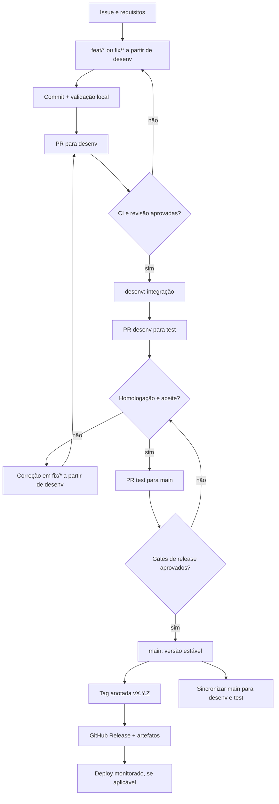

# Padrão operacional de engenharia Git e GitHub | @eisandromc

> **Versão do documento:** 1.3.0  
> **Atualização:** 12/10/2026  
> **Abrangência:** nomenclatura de repositórios, commits, branches, construção, manutenção, tags e releases.  
> **Natureza:** norma operacional **proposta**, a ser adotada por repositório; não é configuração já aplicada ao GitHub.  
> **Aplicação:** projetos pessoais, profissionais, didáticos, experimentais e de equipe. As políticas efetivas de cada projeto, seus contratos, licenças e restrições de acesso prevalecem sobre exemplos deste documento.

## Sumário

1. [Princípios e níveis de exigência](#1-principios-e-niveis-de-exigencia)
2. [Padrão definitivo de nomes](#2-padrao-definitivo-de-nomes)
3. [Catálogo de prefixos e exemplos](#3-catalogo-de-prefixos-e-exemplos)
4. [Padrão de commits](#4-padrao-de-commits)
5. [Versionamento de código e SemVer](#5-versionamento-de-codigo-e-semver)
6. [Governança das branches main, desenv e test](#6-governanca-das-branches-main-desenv-e-test)
7. [Workflow de projeto criado do zero](#7-workflow-de-projeto-criado-do-zero)
8. [Workflow de alterações, correções e inclusões](#8-workflow-de-alteracoes-correcoes-e-inclusoes)
9. [Workflow de homologação, tags e release](#9-workflow-de-homologacao-tags-e-release)
10. [Hotfix, rollback e manutenção pós-release](#10-hotfix-rollback-e-manutencao-pos-release)
11. [Qualidade, automações e configuração do GitHub](#11-qualidade-automacoes-e-configuracao-do-github)
12. [Templates operacionais reutilizáveis](#12-templates-operacionais-reutilizaveis)
13. [Casos completos de execução](#13-casos-completos-de-execucao)
14. [Checklist de auditoria e implantação](#14-checklist-de-auditoria-e-implantacao)
15. [Fontes, proveniência e limites](#15-fontes-proveniencia-e-limites)

---

## 1. Princípios e níveis de exigência

1. **Rastreabilidade:** toda mudança deve registrar sua finalidade e, quando possível, uma Issue/PR.
2. **Reprodutibilidade:** o usuário deve conseguir instalar ou executar um projeto publicado que se declara funcional.
3. **Previsibilidade:** o nome do repositório, a mensagem de commit, as branches e o número da versão têm significados diferentes, complementares e estáveis.
4. **Integridade:** preservar autoria, licenças, histórico e créditos; não publicar segredos nem dados pessoais de estudantes e clientes.
5. **Entrega verificável:** um commit não equivale a deploy; uma tag não equivale a GitHub Release; um workflow presente não garante execução; um PR aprovado não garante validação em produção.
6. **Menor complexidade suficiente:** repositórios de exercícios podem adotar menos gates do que aplicações com usuários, dados sensíveis ou dependências de produção.
7. **Branches de ambientes:** neste padrão, as branches `main`, `desenv`, `test` têm funções explícitas. Não confundir a branch `test` com um diretório de testes automatizados.

**Perfis de governança:**

| Classe | Exemplos | Requisitos mínimos |
|---|---|---|
| A — Produção e cliente | SaaS, API pública, sistema operacional | Issues/PRs, revisão independente, CI, homologação, versionamento, changelog, rollback, gestão de segredos |
| B — Projeto público ou colaborativo | Ferramentas, bibliotecas, open source | PR/CI, documentação, licença definida, tags/releases quando distribuído |
| C — Didático e demonstração | `lab-*`, `lesson-*`, `demo-*` | README reproduzível, indicação de escopo e limitações, validação adequada; SemVer/releases somente se houver distribuição versionada |
| D — Exploração privada | `poc-*`, `experiment-*` | registro claro, sem alegações de produção; simplificações autorizadas |

Para projetos A e B, usar o fluxo integral `feature → desenv → test → main`. Para os projetos C e D, a organização pode deliberadamente simplificar a operação, **mas não é correto afirmar uso dos três ambientes quando não estiverem configurados**.

### 1.1 Vocabulário do processo

- **Issue:** tarefa, defeito ou solicitação rastreável.
- **Commit:** registro atômico de mudanças no Git.
- **Branch:** linha de desenvolvimento.
- **Pull request (PR):** pedido de revisão e integração entre branches.
- **CI:** execução automática de verificações, dependente de workflow configurado.
- **Ambiente de teste/homologação:** instância real de aplicação; a branch `test` não cria esse ambiente automaticamente.
- **Tag:** referência Git para um commit identificado.
- **Release:** entrega publicada com versão, notas e, se aplicável, binários/artefatos.
- **Deploy:** implantação de uma versão em um ambiente. Pode ocorrer após um release ou em outra etapa, conforme arquitetura.

---

## 2. Padrão definitivo de nomes

### 2.1 Regra de formação

**Padrão recomendado:** `tipo-dominio-finalidade`, ou somente `nome-do-produto` para marcas estáveis.

```text
lab-css-container-queries       # laboratório educacional
api-catalogo-produtos           # API de domínio definido
cli-auditoria-windows           # ferramenta de linha de comando
course-html-fundamentos         # curso estruturado
SummumOpus                      # marca própria preservada
```

**Regras editoriais:**

- Preferir `kebab-case`: minúsculas, números e hífens, sem espaços nem acentos.
- Escolher o prefixo com base **no que o repositório é**, não em toda a tecnologia que utiliza.
- Buscar nomes curtos, claros e memoráveis; em geral de 2 a 4 unidades semânticas, sem limite rígido artificial.
- Evitar termos vagos (`teste-final`, `projeto-novo`, `codigo-v2`, `final-corrigido`).
- Não colocar `v1`, `v2`, `final`, `novo`, nome de branch ou data de release no nome: usar tags/releases.
- Evitar redundância (`app-webapp-sistema-*`) e prefixos que exagerem o estágio do projeto (`saas-*` para um protótipo estático).
- Empresas, marcas, turmas, clientes, estudantes e colaboradores exigem identificação e autorização adequadas.
- Conservar nomes de produto quando houver marca, links, usuários ou integrações dependentes.
- **Exceção obrigatória do perfil:** `eisandromc/eisandromc` mantém esse nome para apresentação no GitHub.

### 2.2 Matriz de escolha rápida

| Situação | Usar | Evitar |
|---|---|---|
| Exercício com JavaScript DOM | `lab-js-dom` | `projeto-atividade-4-v7` |
| Curso com capítulos | `course-php-fundamentos` | `site-php` |
| API real | `api-banca-avaliativa` | `microservice-banca` sem independência real |
| Demonstração sem backend | `demo-arquitetura-web` | `microservice-web` por simples simulação |
| Produto com nome próprio | `rotalocal` | mudar marca apenas por estética |
| Integração | `integration-moodle-erp` | `api-erp` sem API implementada |
| Estudo científico em andamento | `research-ia-educacao` | `paper-ia-educacao` sem artigo efetivo |

### 2.3 Metadados mínimos

- **Description:** uma frase objetiva contendo finalidade, público e resultado, sem alegações não verificadas.
- **Topics:** de preferência 4 a 8 relevantes; tecnologia, domínio, público e maturidade. Não usar tópicos falsos.
- **Homepage:** endereço real de demonstração ou documentação; não preencher com URL inexistente.
- **README:** visão geral, funcionalidades, status, requisitos, execução, demonstrações, limitações, licença/autoria.
- **Licença:** definida segundo direitos, contratos e titularidade. A ausência de licença aberta não significa que o conteúdo possa ser reutilizado livremente.
- **Imagem de social preview:** útil para projetos públicos divulgados nas redes.
- **Issue templates, PR template, CONTRIBUTING e SECURITY:** quando fizer sentido para colaboração e distribuição.

### 2.4 Antes de renomear um repositório existente

1. Levantar URLs em outros sites, dependências, ferramentas, `git remote`, páginas, automações, links, documentação e menções públicas.
2. Conferir proprietários, permissões, créditos, licenças e impacto sobre colaboradores.
3. Renomear apenas com autorização do responsável pelo projeto.
4. Atualizar origin no clone: `git remote set-url origin https://github.com/OWNER/NOVO-NOME.git`.
5. Corrigir GitHub Pages, badges, GitHub Actions referenciadas por outros projetos e integrações.
6. Verificar os links antigos e não reutilizar o nome original para não quebrar redirecionamentos.

O GitHub redireciona muitos caminhos após uma renomeação, porém **GitHub Pages e chamadas a actions hospedadas no repositório têm limitações específicas**. Consulte a documentação oficial antes da operação.

---

## 3. Catálogo de prefixos e exemplos

O catálogo reúne **124 prefixos, cada um listado uma única vez**. Os exemplos são **hipotéticos**: não representam projetos criados, instalados, publicados ou testados. O catálogo reutiliza e amplia o padrão editorial preparado anteriormente para `@eisandromc`.

### Aplicações e produtos

| Prefixo | Quando usar | Exemplo |
|---|---|---|
| `app-` | Aplicação demonstrável de uso geral | `app-agenda-academica` |
| `webapp-` | Aplicação web com fluxo completo no navegador | `webapp-plataforma-cursos` |
| `mobile-` | Aplicação mobile como finalidade principal | `mobile-agenda-estudante` |
| `site-` | Site institucional ou de apresentação | `site-portfolio-sandro` |
| `landing-` | Página única de divulgação ou captação | `landing-workshop-ia` |
| `ecommerce-` | Loja virtual com catálogo e compra | `ecommerce-kicks-store` |
| `crm-` | Gestão de relacionamento com clientes | `crm-relacionamento-clientes` |
| `erp-` | Gestão integrada de processos internos | `erp-gestao-operacional` |
| `saas-` | Produto oferecido como serviço, com contas e cobrança reais | `saas-agendamento-equipes` |
| `desktop-` | Aplicação instalada no sistema operacional | `desktop-organizador-arquivos` |

### Frontend e design

| Prefixo | Quando usar | Exemplo |
|---|---|---|
| `frontend-` | Interface que consome uma API separada | `frontend-dashboard-analytics` |
| `ui-` | Telas ou interface visual sem regra de negócio própria | `ui-catalogo-produtos` |
| `component-` | Componente isolado e reutilizável | `component-tabela-acessivel` |
| `design-system-` | Conjunto de tokens, componentes e diretrizes | `design-system-educacao` |
| `design-` | Acervo de design: dados, imagens, identidade visual e regras de uso, sem componentes de código | `design-marca-sandro` |
| `theme-` | Tema visual aplicável a outro projeto | `theme-dashboard-claro` |
| `layout-` | Estudo ou modelo de estrutura de página | `layout-css-grid` |
| `animation-` | Animações, transições e microinterações | `animation-transicoes-ui` |
| `widget-` | Elemento embutível em outras páginas | `widget-cronometro-bancas` |
| `accessibility-` | Soluções e exemplos com foco em acessibilidade | `accessibility-formularios-web` |
| `pwa-` | Aplicação web instalável e com uso offline | `pwa-checklist-estudos` |

### Backend e integrações

| Prefixo | Quando usar | Exemplo |
|---|---|---|
| `api-` | API com contrato e endpoints implementados | `api-banca-avaliativa` |
| `backend-` | Servidor com regras de negócio, sem contrato público de API | `backend-gestao-escolar` |
| `service-` | Serviço com responsabilidade única | `service-notificacoes` |
| `microservice-` | Serviço independente, com deploy e dados próprios | `microservice-catalogo` |
| `integration-` | Ligação entre dois ou mais sistemas existentes | `integration-moodle-erp` |
| `connector-` | Adaptador para um serviço externo específico | `connector-google-drive` |
| `webhook-` | Receptor ou emissor de eventos via webhook | `webhook-inscricoes-eventos` |
| `sdk-` | Biblioteca cliente para consumir uma API | `sdk-api-escolar` |
| `gateway-` | Ponto único de entrada para vários serviços | `gateway-servicos-academicos` |

### Inteligência artificial e automação

| Prefixo | Quando usar | Exemplo |
|---|---|---|
| `ai-` | Aplicação cujo valor principal vem de IA | `ai-assistente-estudos` |
| `rag-` | Busca em base de conhecimento combinada a um modelo | `rag-acervo-pedagogico` |
| `agent-` | Agente que decide e executa ações com ferramentas | `agent-revisor-codigo` |
| `mcp-` | Servidor ou cliente do Model Context Protocol | `mcp-acervo-cursos` |
| `workflow-` | Fluxo de etapas orquestradas | `workflow-publicacao-conteudo` |
| `automation-` | Automação de tarefa repetitiva | `automation-pareceres` |
| `bot-` | Robô de conversa ou de resposta automática | `bot-duvidas-programacao` |
| `prompt-` | Coleção versionada de prompts | `prompt-plano-aula` |
| `eval-` | Avaliação da qualidade de respostas de modelos | `eval-respostas-rag` |
| `llm-` | Experimentos diretos com modelos de linguagem | `llm-experimentos-contexto` |

### Dados e análise

| Prefixo | Quando usar | Exemplo |
|---|---|---|
| `data-` | Projeto centrado em dados e indicadores | `data-indicadores-educacionais` |
| `dataset-` | Conjunto de dados publicado e documentado | `dataset-exemplos-sql` |
| `etl-` | Extração, transformação e carga de dados | `etl-frequencia-academica` |
| `pipeline-` | Sequência automatizada de processamento | `pipeline-importacao-csv` |
| `analytics-` | Análise de comportamento ou desempenho | `analytics-aprendizagem` |
| `dashboard-` | Painel de visualização de indicadores | `dashboard-projetos-escolares` |
| `model-` | Modelo estatístico ou de aprendizado de máquina | `model-previsao-demanda` |
| `notebook-` | Análise exploratória em notebooks | `notebook-analise-dados` |
| `db-` | Esquema, scripts e dados de banco | `db-loja-mysql` |
| `warehouse-` | Armazém de dados para consultas analíticas | `warehouse-indicadores-cursos` |

### DevOps, infraestrutura e operações

| Prefixo | Quando usar | Exemplo |
|---|---|---|
| `infra-` | Configuração de infraestrutura de um ambiente | `infra-laboratorio-web` |
| `iac-` | Infraestrutura descrita como código | `iac-terraform-ambiente` |
| `docker-` | Imagens e composições de contêineres | `docker-php-mysql` |
| `k8s-` | Manifestos e configurações de Kubernetes | `k8s-plataforma-cursos` |
| `ci-` | Pipeline de integração contínua | `ci-testes-front-end` |
| `github-action-` | Action reutilizável do GitHub | `github-action-validar-readme` |
| `monitor-` | Verificação de disponibilidade e alertas | `monitor-servicos-web` |
| `observability-` | Logs, métricas e rastreamento | `observability-apis` |
| `ops-` | Scripts de operação e manutenção | `ops-auditoria-windows` |
| `release-` | Ferramenta específica de publicação e versionamento | `release-gerador-notas` |
| `migration-` | Migração isolada, documentada e aplicável | `migration-mysql-postgres` |

### Bibliotecas, ferramentas e utilitários

| Prefixo | Quando usar | Exemplo |
|---|---|---|
| `lib-` | Biblioteca importada por outros projetos | `lib-validacao-formularios` |
| `pkg-` | Pacote publicado em gerenciador de pacotes | `pkg-componentes-web` |
| `cli-` | Ferramenta de linha de comando | `cli-auditoria-sistema` |
| `tool-` | Ferramenta de apoio com interface própria | `tool-gerador-documentacao` |
| `utils-` | Funções utilitárias pequenas e genéricas | `utils-formatacao-datas` |
| `plugin-` | Extensão para outro software | `plugin-editor-markdown` |
| `extension-` | Extensão de navegador ou editor | `extension-vscode-educacao` |
| `parser-` | Leitura e interpretação de formatos | `parser-csv-validacao` |
| `generator-` | Gerador de código ou de arquivos | `generator-crud-php` |
| `starter-` | Base mínima configurada para iniciar um tipo de projeto | `starter-api-php-pdo` |
| `template-` | Repositório marcado como template no GitHub | `template-frontend-vite` |

### Educação e materiais didáticos

| Prefixo | Quando usar | Exemplo |
|---|---|---|
| `course-` | Curso estruturado em módulos | `course-html-fundamentos` |
| `lesson-` | Aula única com objetivo definido | `lesson-poo-php` |
| `classroom-` | Material de aula de uma disciplina ou turma: slides, roteiros, exercícios e códigos usados em sala | `classroom-desenvolvimento-web` |
| `lab-` | Prática guiada em laboratório | `lab-javascript-dom` |
| `workshop-` | Oficina com roteiro e duração definidos | `workshop-ia-negocios` |
| `exercise-` | Lista de exercícios | `exercise-sql-joins` |
| `challenge-` | Desafio com critério de conclusão | `challenge-css-responsivo` |
| `quiz-` | Perguntas de verificação de aprendizagem | `quiz-logica-programacao` |
| `simulator-` | Simulação interativa de um conceito | `simulator-flexbox-grid` |
| `training-` | Treinamento corporativo ou de equipe | `training-git-github` |
| `curriculum-` | Matriz curricular ou trilha completa | `curriculum-desenvolvimento-web` |

### Pesquisa e documentação

| Prefixo | Quando usar | Exemplo |
|---|---|---|
| `research-` | Pesquisa em andamento | `research-ia-educacao` |
| `study-` | Estudo comparativo ou exploratório | `study-acessibilidade-web` |
| `paper-` | Artigo científico efetivamente produzido | `paper-avaliacao-automatica` |
| `report-` | Relatório técnico | `report-padroes-arquitetura` |
| `docs-` | Documentação desacoplada de uma aplicação | `docs-api-escolar` |
| `guide-` | Guia passo a passo | `guide-xampp-php-mysql` |
| `handbook-` | Manual de referência de uma prática | `handbook-projetos-integradores` |
| `cheatsheet-` | Resumo de consulta rápida | `cheatsheet-git-comandos` |
| `catalog-` | Catálogo organizado de itens | `catalog-livros-tecnologia` |
| `reference-` | Material de referência técnica | `reference-css-moderno` |

### Testes, qualidade e segurança

| Prefixo | Quando usar | Exemplo |
|---|---|---|
| `test-` | Suíte de testes mantida separadamente | `test-api-catalogo` |
| `qa-` | Roteiros e evidências de garantia de qualidade | `qa-acessibilidade-web` |
| `benchmark-` | Comparação de desempenho entre soluções | `benchmark-consumo-memoria` |
| `perf-` | Otimização de desempenho de um sistema | `perf-carregamento-site` |
| `audit-` | Auditoria autorizada de código ou dependências | `audit-dependencias` |
| `security-` | Práticas seguras e auditorias autorizadas | `security-checklist-web` |
| `lint-` | Regras de estilo e análise estática | `lint-padroes-javascript` |
| `validation-` | Validação de dados ou arquivos | `validation-arquivos-csv` |
| `fixture-` | Dados fixos para testes | `fixture-dados-escolares` |
| `mock-` | Simulação de serviços para testes | `mock-servicos-pagamento` |

### Experimentação e arquitetura

| Prefixo | Quando usar | Exemplo |
|---|---|---|
| `poc-` | Prova de conceito para validar uma hipótese | `poc-autenticacao-passkey` |
| `prototype-` | Protótipo navegável sem compromisso de produção | `prototype-portal-aluno` |
| `experiment-` | Experimento técnico pontual | `experiment-css-has` |
| `demo-` | Demonstração de um recurso ou conceito | `demo-container-queries` |
| `playground-` | Espaço livre para testar uma tecnologia | `playground-typescript` |
| `example-` | Exemplo mínimo de uso | `example-pdo-crud` |
| `architecture-` | Modelo ou estudo de arquitetura | `architecture-modulos-web` |
| `case-study-` | Estudo de caso documentado | `case-study-ecommerce` |
| `comparison-` | Comparação lado a lado de abordagens | `comparison-css-grid-flex` |
| `sandbox-` | Ambiente isolado para testes descartáveis | `sandbox-componentes` |

### Comunidade e conteúdo

| Prefixo | Quando usar | Exemplo |
|---|---|---|
| `community-` | Projeto mantido por ou para uma comunidade | `community-developers-rs` |
| `talk-` | Material de palestra | `talk-ia-first` |
| `slides-` | Apresentação de slides | `slides-arquitetura-apis` |
| `video-` | Código e roteiro de vídeo | `video-php-poo` |
| `article-` | Exemplos e código de artigos ou posts publicados no LinkedIn, Medium, DEV, TabNews e outras plataformas | `article-css-container-queries` |
| `content-` | Planejamento editorial, como pautas, calendário e roteiros de publicação | `content-calendario-editorial` |
| `newsletter-` | Edições de newsletter | `newsletter-dev-educacao` |
| `event-` | Organização ou material de evento | `event-maratona-programacao` |
| `mentor-` | Material de mentoria | `mentor-carreira-junior` |
| `showcase-` | Vitrine de projetos | `showcase-projetos-alunos` |
| `awesome-` | Lista curada de recursos | `awesome-recursos-programacao` |

**Decisão editorial:** `lab-` deve ser o principal identificador de material prático educacional; `app-` deve indicar uma aplicação demonstrável; `poc-` e `experiment-` devem deixar explícito o caráter exploratório. É permitido misturar linguagens, mas não misturar o significado do prefixo.

---

## 4. Padrão de commits

### 4.1 Fontes do padrão e decisão de compatibilidade

Adota-se **Conventional Commits 1.0.0** (CONVENTIONAL COMMITS, 2019) e a taxonomia exemplificada em [iuricode/padroes-de-commits](https://github.com/iuricode/padroes-de-commits) (SILVA, [20--]). A referência do iuricode oferece tipos adicionais (`raw`, `cleanup`, `remove`), sugestões de emojis, exemplos e um hook `commit-msg`. Esses tipos extras **não fazem parte do núcleo obrigatório** da especificação Conventional Commits.

Para preservar a compatibilidade com ferramentas de validação de commits, changelogs e semantic-release, a **forma canônica deste manual começa com o tipo**. Emojis são **opcionais após a descrição**, em vez de prefixar o cabeçalho como em alguns exemplos do iuricode. Isso é uma decisão de adaptação do padrão, não uma reprodução literal da referência.

**Formato:**

```text
<tipo>(<escopo opcional>)!: <descrição no imperativo>

<corpo opcional: por quê, impacto, migração, riscos, testes>

<rodapé opcional: Refs #123, Closes #123, BREAKING CHANGE: ...>
```

Regras sugeridas: título de até **72 caracteres** sempre que viável (diretriz editorial, não requisito oficial), tipo em minúsculas, verbo preciso, um assunto predominante por commit, corpo com motivação quando necessário e **nenhuma informação sensível**. O limite de quatro palavras da referência iuricode é uma recomendação daquele projeto, não uma exigência universal; aqui a prioridade é clareza.

**Summary e Description:** no GitHub Desktop, no VS Code e na interface web, o commit tem dois campos. O **Summary** é a primeira linha: `<tipo>(<escopo>): <descrição>`. A **Description** é o corpo: explica o motivo, o impacto e como a mudança foi verificada. Na linha de comando, cada `-m` vira um parágrafo: o primeiro é o Summary e os seguintes formam a Description.

```bash
git commit -m "feat(carrinho): adicionar cálculo de frete" \
  -m "Calcula o frete pelo CEP de destino antes do fechamento do pedido. Testado com CEPs válidos, inválidos e fora da área de entrega."
```

**Exemplos válidos:**

| Summary | Description |
|---|---|
| `feat(carrinho): adicionar cálculo de frete` | Calcula o frete pelo CEP de destino antes do fechamento do pedido. Testado com CEPs válidos, inválidos e fora da área de entrega. |
| `fix(api): corrigir validação de CPF` | CPFs com dígitos repetidos, como 111.111.111-11, eram aceitos. A validação agora rejeita esses casos e retorna erro 422. |
| `refactor(database): separar consulta e persistência` | Move as consultas para um repositório próprio e deixa os serviços só com regra de negócio. Nenhum comportamento externo muda. |
| `docs(readme): explicar execução no XAMPP` | Inclui o passo a passo de instalação, a configuração do banco e as portas usadas. Instruções testadas no XAMPP 8.2. |
| `test(carrinho): cobrir remoção de produtos` | Adiciona casos para remover o último item, um item inexistente e itens com desconto aplicado. |
| `ci(github): validar testes em pull requests` | Executa a suíte de testes em todo PR para `desenv`, `test` e `main`. O merge fica bloqueado se algum teste falhar. |
| `build(deps): atualizar dependências compatíveis` | Atualiza apenas versões MINOR e PATCH. Testes e build local executados sem regressões. |
| `perf(busca): reduzir consultas repetidas` | Armazena em cache as categorias durante a requisição. A busca caiu de 14 para 3 consultas ao banco. |
| `chore(repo): adicionar templates de issues` | Cria modelos para relato de bug e pedido de funcionalidade, com campos de critério de aceite. |
| `feat(api)!: exigir autenticação em todas as rotas` | Rotas antes públicas passam a exigir token. Clientes sem autenticação recebem erro 401.<br><br>`BREAKING CHANGE: rotas públicas exigem token de acesso.` |

**Exemplo com Description longa e quebra de compatibilidade:**

```text
Summary:
feat(api)!: padronizar versão dos endpoints

Description:
As rotas públicas passam a utilizar o prefixo /v2.
Os clientes que utilizam /v1 precisam atualizar as URLs.

BREAKING CHANGE: remove endpoints públicos sem prefixo de versão.
Refs #42
```

### 4.2 Tipos e emojis de referência

| Tipo | Quando usar | Emoji ilustrativo | Summary | Description |
|---|---|---|---|---|
| `feat` | Recurso novo visível ou API ampliada | ✨ | `feat(usuarios): incluir recuperação de senha` | Envia link de redefinição por e-mail, válido por 30 minutos. |
| `fix` | Correção de comportamento defeituoso | 🐛 | `fix(login): impedir sessão expirada` | A sessão continuava ativa após o prazo. Agora o usuário volta ao login. |
| `docs` | Documentação sem mudança funcional | 📚 | `docs(api): atualizar exemplos de requests` | Corrige os exemplos de autenticação e inclui respostas de erro. |
| `test` | Testes novos ou ajustados | 🧪 | `test(usuarios): incluir casos inválidos` | Cobre e-mail vazio, senha curta e cadastro duplicado. |
| `build` | Build, empacotamento e dependências | 📦 | `build(deps): atualizar biblioteca de validação` | Atualiza para a versão 4.2.1, que corrige uma falha de segurança. |
| `perf` | Melhoria de desempenho sem alterar contrato | ⚡ | `perf(lista): reduzir renderizações` | Memoriza os itens da lista; a rolagem deixou de travar com 500 itens. |
| `style` | Formatação sem mudança funcional | 🎨 | `style(css): normalizar espaçamento` | Padroniza recuos e espaços conforme o `.editorconfig`. |
| `refactor` | Reorganizar código sem alterar resultado | ♻️ | `refactor(pdo): extrair repositório` | Separa o acesso ao banco dos controladores. Comportamento inalterado. |
| `chore` | Manutenção interna e configuração geral | 🔧 | `chore(repo): atualizar gitignore` | Ignora pastas de cache e arquivos de ferramentas locais. |
| `ci` | Pipelines e verificações automatizadas | 🧱 | `ci(actions): adicionar job de lint` | Executa o lint em todo PR e bloqueia o merge em caso de erro. |
| `raw`* | Dados/parametrizações, por convenção da equipe | 🗃️ | `raw(seed): atualizar categorias de exemplo` | Inclui três categorias novas nos dados de demonstração. |
| `cleanup`* | Limpeza de código desnecessário | 🧹 | `cleanup(frontend): remover CSS não utilizado` | Remove 40 regras sem uso identificadas na auditoria de estilos. |
| `remove`* | Remoção de arquivos/funções obsoletas | 🗑️ | `remove(legacy): excluir script descontinuado` | O script foi substituído pela rotina de importação em março. |
| `revert` | Reversão de alteração | ↩️ | `revert: reverter integração de cache` | Desfaz o commit a1b2c3d, que gerava dados desatualizados na listagem. |

*Tipos estendidos inspirados na taxonomia iuricode: devem ser incluídos explicitamente na configuração de lint se forem utilizados. É aceitável substituí-los por `chore`, `refactor`, `fix` ou `feat` de acordo com a consequência real da mudança. Para limpeza de dados, observar contratos e impactos na compatibilidade.*

### 4.3 O que exige MAJOR, MINOR ou PATCH

- `feat` compatível com a API pública: **MINOR**, em versões estáveis.
- `fix` compatível: **PATCH**, em versões estáveis.
- `BREAKING CHANGE:` ou `!` após tipo/escopo: **MAJOR**, independentemente do tipo.
- `docs`, `test`, `ci`, `chore`, `build`, `style`, `refactor` não possuem incremento SemVer **automático pela especificação**, salvo quebra de compatibilidade; a política de release decide se há nova versão.
- Não presumir que todo `perf` seja PATCH sem verificar o contrato e o comportamento da ferramenta de automação configurada.
- Em versões `0.x.y`, a compatibilidade segue a política de pré-estabilidade publicada pelo projeto; não aplicar a regra de MAJOR automaticamente sem considerar SemVer.

### 4.4 Associação a issues e PRs

```text
Summary:
feat(api): adicionar paginação de produtos

Description:
Permite consulta incremental com parâmetros de limite e cursor.
Testado com lista vazia e resultados extensos.

Refs #28
```

No PR, utilizar `Closes #28` (ou `Fixes #28`) quando a intenção for encerrar a issue após o merge na branch padrão. Referências como `Refs #28` não fecham automaticamente a issue.

### 4.5 Política para squash e histórico

- **PR de feature → `desenv`:** permitir *Squash and merge* para manter um commit semântico por mudança aprovada; garantir que o título final do commit siga Conventional Commits.
- **PR de promoção `desenv → test` e `test → main`:** preferir *Create a merge commit* para manter a ancestralidade das branches, facilitar rastreabilidade e reduzir conflitos de promoção.
- **Consequência:** não ativar simultaneamente **Require linear history** se o método adotado para promoção utiliza merge commits. Definir outro método somente se a política do projeto for redesenhada conscientemente.
- Nunca usar *force push* nas branches compartilhadas `main`, `desenv` e `test`.

### 4.6 Hooks e validação

Um hook `commit-msg` local é útil, mas **não basta para impor o padrão aos colaboradores**: hooks não são versionados automaticamente nem executam do lado do servidor. Utilizar também validação em CI/PR (por exemplo, commitlint) para a política ser verificável.

> Atenção: ferramentas convencionais esperam o tipo no início da mensagem. Se a equipe quiser emoji antes do tipo, será necessário configurar parser/linter customizado; o formato deste manual evita essa dependência.

---

## 5. Versionamento de código e SemVer

Adotar **Semantic Versioning 2.0.0** (PRESTON-WERNER, [2013]) para produtos e bibliotecas que tenham contrato de uso público: `MAJOR.MINOR.PATCH`.

```text
v1.0.0         primeira versão estável do produto
v1.0.1         correção compatível (PATCH)
v1.1.0         novo recurso compatível (MINOR)
v2.0.0         mudança incompatível (MAJOR)
v2.1.0-rc.1    candidato de release, pré-lançamento
v2.1.0-beta.2  versão beta
```

- Versão `0.1.0`: pode ser apropriada antes de estabilizar o contrato público. Em `0.y.z`, mudanças incompatíveis ainda podem ocorrer, mas devem ser **documentadas**.
- Definir o que constitui a API pública: endpoints, CLI, SDK, schemas, formatos de arquivos, flags, contratos de integração e funcionalidades prometidas.
- Uma versão já publicada não deve ser alterada silenciosamente: emitir nova versão para novas alterações.
- Para documentos e cursos sem software distribuído, SemVer é **opcional**. Revisões editoriais podem usar outro esquema registrado; se adotar SemVer, documentar quais mudanças representam MAJOR/MINOR/PATCH.
- Para produtos da linha Perestroika Major 3, respeitar o `3.x.y` somente quando o projeto realmente pertence a essa linha de versionamento. Não forçar todas as aplicações pessoais a utilizarem major `3`.

### 5.1 Tag vs release vs deploy

| Elemento | Exemplo | Significado |
|---|---|---|
| Commit | `7d41...` | Estado de código identificado por hash |
| Tag anotada | `v1.2.0` | Referência persistente para um commit |
| GitHub Release | `v1.2.0` com notas | Divulgação da entrega versionada |
| Artefato | `app-1.2.0.zip`, pacote container | Entregável produzido e validado |
| Deploy | Ambiente de produção aponta a `v1.2.0` | Execução efetiva da versão |

Uma tag sozinha **não publica** um GitHub Release. Um GitHub Release sozinho **não comprova** que a versão foi implantada. Uma versão em produção precisa de evidências do deploy e monitoramento conforme o projeto.

---

## 6. Governança das branches main, desenv e test

### 6.1 Propósito

| Branch | Papel | Merge de entrada permitido | Gate |
|---|---|---|---|
| `main` | Código aprovado/release estável | PR de `test`; `hotfix/*` sob exceção controlada | CI, revisão, validação de homologação, autorização de release |
| `test` | Candidato a release em homologação | PR de `desenv`; correções seguem novamente por `desenv` | CI + QA funcional + aceite |
| `desenv` | Integração contínua do trabalho em desenvolvimento | PR de `feat/*`, `fix/*`, `refactor/*`, etc.; sincronização de `main` | Lint, testes, revisão conforme classe |
| `feat/*` | Nova funcionalidade | Nasce de `desenv` e volta a `desenv` | PR e testes |
| `fix/*` | Correção não urgente | Nasce de `desenv` e volta a `desenv` | PR e testes |
| `hotfix/*` | Correção urgente em produção | Nasce de `main`; integra `main` e volta a `desenv` e `test` | revisão e testes mínimos obrigatórios |
| `release/*` (opcional) | Congelamento de release complexo | Conforme política de release | controle adicional, não substitui `test` |

**Nomes auxiliares:**

```text
feat/42-carrinho-de-compras
fix/58-validacao-email
refactor/71-repositorio-pdo
docs/65-guia-instalacao
test/83-cobertura-api
chore/90-github-actions
hotfix/101-erro-login-producao
```

Nunca criar novas features diretamente em `main` ou `test` no fluxo padrão.

### 6.2 Fluxo de promoção



**Observação:** o nó de sincronização é um lembrete de manter bases futuras atualizadas, não um convite a reset ou force-push das branches. Por exemplo, após release e fechamento de um ciclo, atualizar `desenv` pela `main` aprovada; depois, preparar `test` para a próxima rodada de homologação via PR de promoção. A estratégia exata depende de como PRs foram mesclados e de existirem mudanças em paralelo.

### 6.3 Contrato dos ambientes

- `desenv`: testes de integração de branches e eventualmente deploy em desenvolvimento.
- `test`: deploy de homologação com dados de teste/sintéticos e checklist de aceite.
- `main`: fonte para artefatos de produção (ou para release manual aprovado).
- **Não reutilizar credenciais nem dados reais de produção no ambiente de homologação.**
- Configurar ambientes do GitHub (`development`, `staging`, `production`) separadamente; os nomes de ambientes não são branches.
- Configurar aprovações, secrets e permissões conforme classe e capacidades do plano GitHub.

### 6.4 Proteção obrigatória antes de automatizar

| Proteção | `main` | `test` | `desenv` |
|---|---|---|---|
| PR obrigatório | Sim | Sim | Sim (A/B), recomendado C |
| CI requerido | Sim | Sim | Sim |
| Revisão humana | Sim | Sim | Recomendada; obrigatória em A |
| Resolução de discussões | Sim | Sim | Recomendado |
| Force push | Proibido | Proibido | Proibido |
| Delete branch | Proibido | Proibido | Proibido |
| Deploy protegido | Produção | Homologação | Desenvolvimento, se usado |

Na conta individual, uma aprovação independente obrigatória pode inviabilizar o trabalho quando não houver outro colaborador elegível. **Não fingir revisão independente:** adotar auto-revisão documentada enquanto a política permitir, sem habilitar um gate impossível de cumprir. Disponibilidade e limitações de recursos dependem do plano/organização.

---

## 7. Workflow de projeto criado do zero

### 7.1 Definir o produto antes do Git

Registrar no mínimo: problema, público, objetivo, entregáveis, stack, dados, licença, autoria, confidencialidade, riscos, critérios de aceite, política de versionamento e destino de deploy. Confirmar se o repositório será público ou privado.

### 7.2 Criar repositório e estrutura inicial

**Caminho A: projeto criado no GitHub** com README/licença inicial, então clonar. Evitar `git init` com histórico distinto na mesma pasta sem planejamento.

```bash
git clone https://github.com/OWNER/app-exemplo.git
cd app-exemplo
git status
git branch --show-current
```

**Caminho B: projeto totalmente local**, remoto inicialmente vazio:

```bash
mkdir app-exemplo
cd app-exemplo
git init -b main
printf '# App Exemplo\n' > README.md
printf '.env\nnode_modules/\ndist/\n' > .gitignore
git add README.md .gitignore
git commit -m "chore(repo): iniciar estrutura do projeto" \
  -m "Cria README e .gitignore iniciais, sem dependências nem dados reais."
git remote add origin https://github.com/OWNER/app-exemplo.git
git push -u origin main
```

`OWNER` e `app-exemplo` são placeholders; comandos do caminho B devem ser usados somente depois de criar um repositório remoto vazio, com permissões e política de autoria adequadas. No Windows sem shell compatível, crie os arquivos no editor e execute apenas os comandos `git`.

### 7.3 Criar as três branches compartilhadas

A partir da versão inicial da `main`:

```bash
git switch main
git pull --ff-only origin main
git switch -c desenv
git push -u origin desenv
git switch main
git switch -c test
git push -u origin test
git switch main
```

**Depois dos pushes:** configurar proteções das três branches no GitHub antes do primeiro trabalho colaborativo; definir `main` como default. Para novos projetos, preferir o conteúdo inicial sem dependências pesadas, sem dados reais e sem segredos. Nunca reutilizar um `git init` local não relacionado sobre um repositório remoto com commits existentes.

### 7.4 Estrutura mínima recomendada

```text
app-exemplo/
├── README.md
├── LICENSE                     # somente se o licenciamento tiver sido decidido
├── CHANGELOG.md                 # quando houver releases
├── .gitignore
├── .editorconfig
├── .env.example                 # sem chaves/senhas reais
├── docs/
│   ├── arquitetura.md
│   └── operacao.md
├── src/
├── tests/
└── .github/
    ├── workflows/ci.yml
    ├── PULL_REQUEST_TEMPLATE.md
    └── ISSUE_TEMPLATE/
```

Não criar diretórios vazios apenas para aparentar maturidade: adaptar à stack e ao produto. **Nunca adicionar `.env`, tokens, dados pessoais, arquivos de cliente não autorizados ou chaves privadas.**

### 7.5 Checklist do primeiro commit

- [ ] Nome e descrição coerentes.
- [ ] Licença/autoria conferidas.
- [ ] README com status e modo de execução.
- [ ] `.gitignore` para stack; `.env.example` sem segredos.
- [ ] Dependências reprodutíveis, arquivo lock quando aplicável.
- [ ] Branches e proteções configuradas.
- [ ] CI criado e observado executando com resultado válido, se requerido.
- [ ] Issues iniciais registradas e priorizadas.
- [ ] Projeto marcado corretamente: experimental, MVP ou estável.

---

## 8. Workflow de alterações, correções e inclusões

### 8.1 Triagem de demanda (sempre)

```text
Ideia, defeito ou solicitação
→ Issue/registro
→ escopo e impacto
→ classificação feat/fix/refactor/docs/chore/etc.
→ critérios de aceite
→ branch curta
→ implementação e testes
→ PR → revisão → integração
```

Classificar a mudança por **comportamento externo**, não pelo volume de código. Uma exclusão de endpoint que quebra contrato é `BREAKING CHANGE` mesmo que envolva apenas uma linha.

### 8.2 Nova funcionalidade: `feat/*`

```bash
git fetch origin
git switch desenv
git pull --ff-only origin desenv
git switch -c feat/42-filtro-produtos
# ... implementar mudanças e executar testes locais ...
git add src tests docs
git commit -m "feat(catalogo): adicionar filtros de produtos" \
  -m "Permite filtrar por categoria e faixa de preço. Refs #42"
git push -u origin feat/42-filtro-produtos
```

Abrir **PR `feat/42-filtro-produtos` → `desenv`**, descrever problema, solução, testes executados e evidências. Integrar apenas com os gates exigidos. Se o projeto usar squash, revisar a mensagem semântica final do merge.

### 8.3 Correção de bug: `fix/*`

1. Reproduzir o bug em ambiente controlado.
2. Criar teste que capture a falha quando viável.
3. Criar branch a partir de `desenv` e implementar mudança mínima.
4. Executar testes de regressão e conferir impacto em dados existentes.
5. Abrir PR para `desenv` e aguardar integração.
6. Promover para `test`; não corrigir `test` diretamente durante QA.

```bash
git switch desenv
git pull --ff-only origin desenv
git switch -c fix/58-total-carrinho
# ... correção + testes ...
git add src tests
git commit -m "fix(carrinho): corrigir total com desconto" \
  -m "O desconto era aplicado duas vezes quando havia cupom. Refs #58"
git push -u origin fix/58-total-carrinho
```

### 8.4 Inclusão de arquivo, recurso, dados ou conteúdo

| Inclusão | Tipo típico | Validações |
|---|---|---|
| Novo endpoint | `feat(api)` | Contrato, auth, erros, documentação, testes |
| Nova página | `feat(ui)` | Responsividade, acessibilidade, fluxo |
| Nova dependência | `build(deps)` | Licença, vulnerabilidades, arquivo lock |
| Novo conteúdo didático | `docs(course)` / `feat(course)` | Objetivos, pré-requisitos, direitos, exemplos |
| Novo dataset | `raw(data)` / `chore(data)` | Proveniência, privacidade, esquema |
| Novo teste | `test(...)` | Reprodutibilidade, critérios assertivos |
| Nova pipeline | `ci(...)` | Permissões mínimas e execução verificada |
| Remoção de contrato público | `remove(...)!` | Plano de migração, MAJOR, depreciação |

### 8.5 Critérios comuns de PR

- PR pequeno o suficiente para revisão; caso grande, dividir etapas sem criar estados inconsistentes.
- Referência à issue e justificativa contextual.
- Mudanças necessárias, não refatorações não relacionadas.
- Testes locais e CI apropriados.
- Mudanças de API documentadas e versão identificada.
- Interface revisada em dispositivos relevantes e acessibilidade considerada.
- Direitos de imagens, textos, bibliotecas e dados respeitados.
- Riscos, migração, rollback e compatibilidade quando aplicável.

### 8.6 Mudança incompatível

1. Descrever quem será afetado.
2. Planejar depreciação quando possível.
3. Definir versão alvo e estratégia de transição.
4. Atualizar documentação e testes de contratos.
5. Usar `!` e/ou `BREAKING CHANGE:` na mensagem semântica.
6. Obter aceite explícito antes da publicação.

### 8.7 QA encontra um defeito em `test`

Não aplicar um commit improvisado apenas em `test`, pois ele não chegaria automaticamente a `desenv`.

1. Registrar defeito.
2. Criar `fix/*` a partir de `desenv`, implementando e testando a solução.
3. Fazer PR para `desenv`.
4. Atualizar o PR de promoção `desenv → test` com a mudança (ou abrir nova promoção, conforme estado do ciclo).
5. Repetir a homologação afetada.
6. Só então promover `test → main`.

---

## 9. Workflow de homologação, tags e release

### 9.1 Congelamento de escopo

- Identificar commit candidato na `desenv` e lista fechada de funcionalidades.
- Revisar as Issues concluídas, pendências, limitações conhecidas e dívida aceita.
- Confirmar migrações de dados, compatibilidade, segurança e documentação.
- Preparar um plano de rollback compatível com as alterações.

### 9.2 Promoção `desenv → test`

Criar um PR com **base `test` e head `desenv`**. Esta orientação é importante: ela determina a direção real da mudança no GitHub.

No PR, informar versão candidata, escopo, riscos e plano de QA. Aprovar CI, fazer *merge commit* e, se houver infraestrutura, implantar a branch `test` em ambiente de homologação com dados próprios desse ambiente.

**QA mínimo:**

- [ ] Testes unitários/integrados conforme stack.
- [ ] Jornada principal validada de ponta a ponta quando aplicável.
- [ ] Responsividade/acessibilidade verificadas para interfaces.
- [ ] Validação de segurança e configuração.
- [ ] Compatibilidade, dados e migrações conferidos.
- [ ] Logs/monitoramento e pontos de recuperação definidos.
- [ ] Registro de evidências e aceite responsável.

### 9.3 Pré-release (opcional)

Se for útil publicar uma versão para avaliadores, criar uma **tag distinta** apontando para o commit testado em `test`, como `v1.3.0-rc.1`, e um GitHub Release marcado **Pre-release**.

```bash
git fetch origin
git switch test
git pull --ff-only origin test
git tag -a v1.3.0-rc.1 -m "Release candidate v1.3.0-rc.1"
git push origin v1.3.0-rc.1
```

A tag identifica esse **commit candidato**, não significa que ele esteja pronto para produção. Não mover nem sobrescrever a tag se o código mudar; criar `-rc.2`.

### 9.4 Promoção `test → main`

Criar PR com **base `main` e head `test`**, anexando evidências de QA. Quando aprovado, fazer merge sem força, com política de histórico definida (neste modelo, *merge commit*).

Após o merge, confirmar o commit exato em `main` e executar verificações pós-integração. Se o método de merge criou um novo commit, ele **não é o mesmo SHA do candidato `-rc`**; não dizer que os binários são idênticos sem validar cadeia de artefatos e processo de promoção.

### 9.5 Criar a tag estável **no commit aprovado de `main`**

```bash
git fetch origin
git switch main
git pull --ff-only origin main
git status --short
# Confirmar resultado vazio antes de continuar.
git log -1 --oneline
git tag -a v1.3.0 -m "Release v1.3.0"
git push origin v1.3.0
```

Antes de executar, **confirmar que a tag não existe**: `git ls-remote --tags origin refs/tags/v1.3.0`. Não reutilizar tag publicada; não apagar e recriar tags estáveis.

### 9.6 Criar GitHub Release

**Pela interface:** repositório → Releases → Draft a new release → selecionar `v1.3.0` → escrever notas e anexar artefatos verificados → publicar.

**Com GitHub CLI**, depois de autenticar `gh auth login` e de existir a tag:

```bash
gh release create v1.3.0 \
  --verify-tag \
  --title "v1.3.0 | Novas funcionalidades e correções" \
  --notes-file docs/releases/v1.3.0.md
```

O arquivo `docs/releases/v1.3.0.md` precisa existir, ser completo e estar revisado. Publicação por CLI é uma **ação externa**; somente executar após autorização, gates e confirmação de release. Para pré-release, usar `--prerelease` quando aplicável.

### 9.7 Conteúdo obrigatório das release notes

```markdown
# v1.3.0 - 2026-10-12

## Resumo
Descrição objetiva do valor da versão e público afetado.

## Adicionado
- Filtro de produtos por categoria.

## Corrigido
- Total do carrinho com cupom.

## Alterado
- Ajustes de usabilidade e mensagens.

## Compatibilidade e migração
- Sem quebra de compatibilidade nesta versão.

## Riscos e limitações
- Problema conhecido X; workaround Y.

## Validação
- CI: URL real da execução aprovada.
- QA: referência ao registro de aceite.
- Artefatos: nome e hash, quando aplicável.

## Créditos
- Colaboradores reais e contribuições autorizadas.
```

O template é ilustrativo: datas, hashes, URLs, CI e aceite não devem ser preenchidos ficticiamente.

### 9.8 Pós-release

1. Executar deploy da versão aprovada quando o projeto exigir; registrar ambiente, data, versão, responsável e evidência.
2. Verificar saúde, erros e indicadores, comparando com estado anterior.
3. Confirmar que documentação e links apontam para a versão publicada.
4. Sincronizar mudanças estáveis de `main` com `desenv` (PR/merge controlado, sem force push).
5. Preparar `test` para o ciclo seguinte por nova promoção de `desenv`; não assumir que branches divergentes são automaticamente idênticas após merge.
6. Atualizar roadmap/Issues/CHANGELOG e comunicar aos usuários conforme público.

---

## 10. Hotfix, rollback e manutenção pós-release

### 10.1 Hotfix urgente, com exceção documentada

Se um defeito crítico já afeta produção, é aceitável abrir `hotfix/*` **a partir de `main`** para isolar a correção de novidades não liberadas em `desenv`.

```bash
git fetch origin
git switch main
git pull --ff-only origin main
git switch -c hotfix/101-corrigir-login
# ... reproduzir, corrigir, testar e revisar ...
git add src tests
git commit -m "fix(auth): corrigir renovação da sessão" \
  -m "Sessões válidas expiravam antes do prazo em produção. Refs #101"
git push -u origin hotfix/101-corrigir-login
```

Abrir PR `hotfix/... → main`, com validação focada, revisão e autorização de emergência. Após o merge, publicar nova versão PATCH (ex.: `v1.3.1`) conforme passos 9.5 e 9.6, e realizar monitoramento. **Propagar a correção aprovada para `desenv` e para a próxima candidata em `test`**, via PRs ou merges controlados. Não deixar a correção exclusiva de `main`.

Se o projeto exige homologação inclusive para emergências, primeiro validar o hotfix numa candidata de `test` isolada e aprovada; o fluxo excepcional deve estar previsto na política de incidentes.

### 10.2 Reversão segura

- **Código:** preferir `git revert <SHA>` ou PR com correção reversível; preservar auditoria do histórico.
- **Deploy:** reimplantar um **artefato anterior conhecido e validado**, não confundir com mover branch ou apagar tag.
- **Dados:** migrações de banco podem não ser reversíveis; prever backup, estratégia de restauração e compatibilidade com a versão anterior.
- **Segredos comprometidos:** revogar e rotacionar; remover do histórico local não invalida credenciais expostas.
- **Nunca** usar `git reset --hard` seguido de `push --force` em `main`, `test` ou `desenv` como procedimento normal.

### 10.3 Correção depois de release publicado

Se a versão `v1.3.0` já foi publicada e surgiu nova correção, não alterar silenciosamente a tag ou editar binários imutáveis; gerar `v1.3.1`. Se recursos de release imutável estiverem ativados, respeitar suas restrições.

---

## 11. Qualidade, automações e configuração do GitHub

### 11.1 Branch protection / rulesets

Configurar em Settings → Rules/Rulesets ou Branch protection, conforme interface e permissões. Para `main`, `test` e `desenv`, estabelecer o conjunto adequado de regras do §6.4. Um gate só é válido se sua execução real for observada e se tiver origem confiável. Não definir *required status check* antes de o check existir, pois pode bloquear os merges.

**Atenção ao método de merge:** *Require linear history* é incompatível com a política de *merge commits* para promoções deste documento. Escolher conscientemente uma política ou outra.

### 11.2 CI mínimo sugerido (modelo YAML, não ativado)

O exemplo abaixo utiliza somente comandos básicos e confirma integridade do repositório e whitespace. **Não equivale a testes unitários do produto.** Adicione `npm ci && npm test`, `pytest`, `composer test` ou outras verificações **apenas quando as dependências e scripts existirem**.

```yaml
# .github/workflows/ci.yml
name: CI - verificacoes basicas
on:
  pull_request:
    branches: [desenv, test, main]
  push:
    branches: [desenv, test, main]
permissions:
  contents: read
jobs:
  repository-checks:
    runs-on: ubuntu-latest
    steps:
      - name: Checkout
        uses: actions/checkout@v4
        with:
          fetch-depth: 2
      - name: Verificar whitespace e integridade
        shell: bash
        run: |
          git diff-tree --check --root -r HEAD
          git fsck --no-reflogs --no-progress
```

**Limitações desse exemplo:** não valida runtime, links, segurança, commits semânticos ou releases; o comando `git diff-tree` verifica **somente o commit HEAD**, não substitui uma verificação de toda a faixa do PR. Para produção, use um workflow específico à stack e revise os eventos, permissões, pinagem de actions e profundidade de checkout. A política de GitHub Actions deve ser testada com PR real antes de torná-la bloqueante.

### 11.3 Commitlint (orientação de configuração)

Instale/ajuste `@commitlint/cli` e `@commitlint/config-conventional` em projeto Node somente quando usar a ferramenta. Para tipos estendidos (`raw`, `cleanup`, `remove`) editar `type-enum`; não presumir que sejam aceitos pelo preset.

```javascript
// commitlint.config.cjs (exemplo de configuração a revisar)
module.exports = {
  extends: ['@commitlint/config-conventional'],
  rules: {
    'type-enum': [2, 'always', [
      'feat', 'fix', 'docs', 'test', 'build', 'perf',
      'style', 'refactor', 'chore', 'ci',
      'raw', 'cleanup', 'remove', 'revert'
    ]]
  }
};
```

É necessário configurar um hook ou workflow que execute `commitlint` efetivamente. Uma configuração isolada **não prova que a validação esteja ativa**. Se usar squash, validar também o **título final do PR**, porque ele poderá virar o commit de merge.

### 11.4 Metadados e documentação mínimos

| Item | Relevância | Critério |
|---|---|---|
| README | Todos | Descreve uso e estado verdadeiro |
| LICENSE | Conforme direitos | Licença adequada, não inventada |
| CHANGELOG | Software distribuído | Mudanças por versão |
| `.gitignore` | Todos | Sem arquivos temporários ou segredos |
| Dependências e lockfile | Quando aplicável | Build reprodutível |
| `.env.example` | Quando aplicável | Sem segredos |
| CONTRIBUTING | Colaborativo | Como contribuir, executar e testar |
| SECURITY | Produto público sensível | Canal de relato seguro, sem exposição pública |
| CODEOWNERS | Equipes com revisão | Responsáveis reais e disponíveis |
| Topic/Description | Públicos | Descrição precisa, categorias coerentes |
| Issue/PR template | Equipes | Critérios de aceite e verificações explícitos |
| Social preview | Projetos divulgados | Imagem legível e autorizada |

### 11.5 Estados de execução

- **ATIVO:** integração/workflow/ambiente efetivamente habilitado e observável no host.
- **VALIDADO LOCALMENTE:** comandos/arquivos foram verificados em ambiente local, não em produção.
- **PENDENTE:** planejado ou produzido, mas ainda não executado/validado na plataforma.
- **BLOQUEADO:** depende de acesso, permissão ou requisito indisponível.
- **NÃO OBSERVADO:** não existem evidências suficientes para afirmar o estado.

A existência deste documento não torna nenhuma regra **ATIVA** em todos os repositórios.

---

## 12. Templates operacionais reutilizáveis

### 12.1 Issue de feature

```markdown
## Problema e público
Quem enfrenta o problema e em qual contexto?

## Objetivo e comportamento esperado
O que muda do ponto de vista do usuário?

## Escopo e fora de escopo
O que entra e o que não entra nesta entrega?

## Critérios de aceite
- [ ] Cenário principal reproduzível
- [ ] Estados de erro e acessibilidade avaliados
- [ ] Documentação atualizada

## Riscos e dependências
Dados, integrações, segurança, compatibilidade, restrições.
```

### 12.2 Pull Request

```markdown
## Tipo
feat / fix / docs / refactor / perf / chore / ci / test / release

## Problema e solução
Contexto, decisão e motivação.

## Impacto
Quem é afetado? Há mudanças de contrato ou migração?

## Evidências
Comandos executados, resultados observados, logs e/ou screenshots reais.

## Checklist
- [ ] Escopo corresponde à Issue
- [ ] Testes pertinentes executados
- [ ] Documentação e licenciamento revisados
- [ ] Dados sensíveis não incluídos
- [ ] Riscos/rollback descritos quando cabíveis

Refs #123
```

### 12.3 Changelog

```markdown
# Changelog

## [Unreleased]
### Added
### Changed
### Fixed
### Removed

## [1.3.0] - YYYY-MM-DD
### Added
- Filtro de produtos.
### Fixed
- Total do carrinho com desconto.
```

### 12.4 Checklist de nova versão

```markdown
# Release vX.Y.Z

- [ ] Issue/PR de release preparado
- [ ] Escopo congelado
- [ ] CI da desenv aprovado
- [ ] PR desenv → test aprovado
- [ ] QA registrado e evidenciado
- [ ] Compatibilidade, segurança, migrações conferidas
- [ ] PR test → main aprovado
- [ ] Commit de main identificado e validado
- [ ] Tag vX.Y.Z anotada e publicada
- [ ] Release notes revisadas
- [ ] Release publicado com artefatos adequados
- [ ] Deploy executado e observado (se aplicável)
- [ ] Incidentes, métricas e rollback monitorados
- [ ] Sincronização para próximo ciclo realizada
```

---

## 13. Casos completos de execução

### Caso A — iniciar um laboratório educacional

**Objetivo:** ensinar `:has()` e Container Queries.

```text
Nome do repositório: lab-css-moderno
Categoria: C — didático
README: objetivos, conceitos, execução, exemplos e limitações
Branch inicial: main (bootstrap) → desenv + test, se necessário
Branch de trabalho: feat/14-demo-container-queries
Summary: feat(css): adicionar demonstração de container queries
Description: Mostra cards que mudam de layout conforme a largura do contêiner.
PR: feat/... → desenv → test → main
Versão: v0.1.0, somente se desejar distribuir versões identificáveis
Release: opcional para esse material
```

**Aceite:** abrir a demonstração, explicar o comportamento e reproduzi-lo. Não declarar um backend inexistente, nem vender uma demonstração como microsserviços de produção.

### Caso B — adicionar módulo a uma API

**Objetivo:** incluir endpoint de geração de cronograma de bancas.

```text
Nome: api-banca-avaliativa
Issue: #42 - novo endpoint /cronograma
Branch: feat/42-endpoint-cronograma
Summary: feat(cronograma): permitir consulta por turma
Description: Novo endpoint GET /cronograma?turma=. Refs #42
PR: feat/... → desenv
Gate: testes de contrato, validação, autenticação e documentação
Promoção: desenv → test → homologação → main
Versão: v1.2.0, se for funcionalidade compatível na API estável
Tag: v1.2.0 na main aprovada
Release: notas, compatibilidade, migrações, artefatos, deploy
```

**Aceite:** evidenciar API executável, testes reais, permissões e resultado correto. Nenhum desses itens se torna validado pelo simples uso do exemplo.

### Caso C — erro crítico após publicação

```text
Estado: v1.2.0 implantada
Issue: #57 - autenticação falha para sessões válidas
Branch: hotfix/57-renovacao-sessao a partir de main
Summary: fix(auth): ajustar tempo de renovação
Description: Sessões válidas falhavam na renovação. Refs #57
PR: hotfix/... → main (com gates de emergência)
Release: v1.2.1
Propagação: main → desenv e test controladamente
Monitoramento: confirma correção e ausência de regressões
```

**Aceite:** nova versão comprovadamente implantada, correção observada e possibilidade de rollback avaliada.

### Caso D — atualização exclusivamente documental

```text
Nome do repo: docs-api-escolar
Branch: docs/72-revisar-guia
Summary: docs(instalacao): atualizar instruções do XAMPP
Description: Atualiza versões, portas e configuração do banco.
PR: docs/... → desenv, quando o fluxo de três branches for aplicável
Release: facultativo, conforme contrato de publicação documental
```

**Aceite:** comandos testados no ambiente que a documentação promete suportar; links e imagens acessíveis; nenhuma versão inventada.

---

## 14. Checklist de auditoria e implantação

### Antes de adotar o padrão em qualquer repositório

- [ ] Responsável humano aprovou escopo e classificação A/B/C/D.
- [ ] Nome atual e eventual novo nome foram aprovados.
- [ ] Direitos autorais, dados e contratos foram conferidos.
- [ ] Branch padrão atual foi inventariada, com cópia de segurança quando necessário.
- [ ] Política de commits definida, inclusive tipos estendidos.
- [ ] SemVer e API pública definidos, se aplicáveis.
- [ ] Estratégia real de três branches foi decidida e documentada.
- [ ] Proteções e gates compatíveis com equipe e plano GitHub foram configurados.
- [ ] Testes realmente existentes e observados.
- [ ] Processo de tag/release/deploy foi validado em projeto piloto.
- [ ] Um PR de teste percorreu desenv → test → main sem burlar proteções.
- [ ] Release piloto foi publicado apenas com autorização e evidências.

### Ordem de implantação sugerida

1. Aplicar primeiro em **um repositório piloto** não crítico, sem projetos de estudantes/clientes nem dependências de produção.
2. Corrigir documentação e validar sequência de PRs e regras de branch.
3. Executar uma versão de teste do pipeline e auditar sua execução real.
4. Replicar por classe de repositório após ajuste.
5. Não fazer renomeações ou releases em massa sem avaliação individual.

---

## 15. Fontes, proveniência e limites

### Referências

Referências elaboradas conforme a ABNT NBR 6023:2018, em ordem alfabética. Documentos on-line sem data de publicação identificada recebem a data provável entre colchetes.

CONVENTIONAL COMMITS. **Conventional Commits 1.0.0**. [*S. l.*], 2019. Disponível em: https://www.conventionalcommits.org/pt-br/v1.0.0/.

COSTA, Sandro Martins da. **Padrão de nomenclatura GitHub eisandromc**. Porto Alegre, 2026. Documento interno não publicado. Arquivo: `PADRAO_NOMENCLATURA_GITHUB_EISANDROMC.md`.

GITHUB. **About protected branches**. [*S. l.*]: GitHub Docs, [20--]. Disponível em: https://docs.github.com/en/repositories/configuring-branches-and-merges-in-your-repository/managing-protected-branches/about-protected-branches.

GITHUB. **Events that trigger workflows**. [*S. l.*]: GitHub Docs, [20--]. Disponível em: https://docs.github.com/en/actions/reference/workflows-and-actions/events-that-trigger-workflows.

GITHUB. **Gerenciar versões em repositórios**. [*S. l.*]: Documentos do GitHub, [20--]. Disponível em: https://docs.github.com/pt/repositories/releasing-projects-on-github/managing-releases-in-a-repository.

GITHUB. **Managing a branch protection rule**. [*S. l.*]: GitHub Docs, [20--]. Disponível em: https://docs.github.com/en/repositories/configuring-branches-and-merges-in-your-repository/managing-protected-branches/managing-a-branch-protection-rule.

GITHUB. **Renaming a repository**. [*S. l.*]: GitHub Docs, [20--]. Disponível em: https://docs.github.com/en/repositories/creating-and-managing-repositories/renaming-a-repository.

PRESTON-WERNER, Tom. **Versionamento Semântico 2.0.0**. [*S. l.*], [2013]. Disponível em: https://semver.org/lang/pt-BR/.

SILVA, Iuri. **Padrões de commits**. [*S. l.*]: GitHub, [20--]. Disponível em: https://github.com/iuricode/padroes-de-commits.

### O que é fonte vs proposta

- **Fonte normativa externa:** sintaxe de Conventional Commits, princípios de SemVer, ações reais do GitHub, restrições e capacidades da plataforma.
- **Política proposta do ecossistema:** nomes de branches `desenv` e `test`, prefixos `lab-`, `api-` etc., regras de gates, mensagens em português, escolha de merge commit para promoção, classes A/B/C/D, templates, nomenclatura de escopos, prazos e fluxos ilustrativos.
- **Não observado/implementado:** nenhuma branch criada por este arquivo, nenhuma proteção habilitada, nenhum commit registrado, nenhuma tag criada, nenhum release publicado e nenhum deploy executado no GitHub do usuário.

**Critério de aceite deste manual:** documento coerente com Convenções e SemVer, exemplos que não presumem recursos inexistentes e procedimentos de publicação que exigem validação e autorização antes de qualquer efeito externo.
