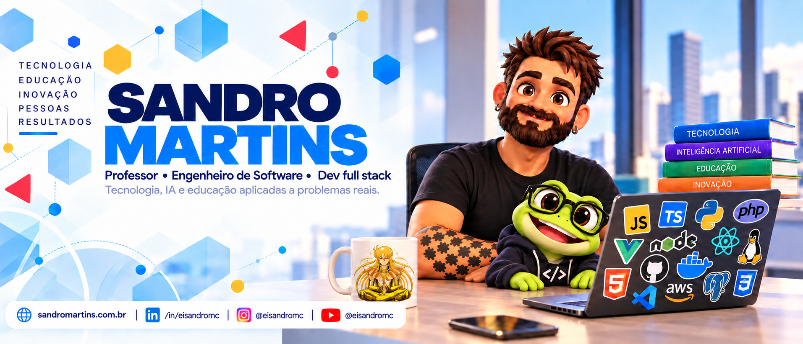
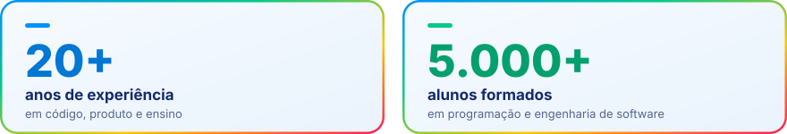
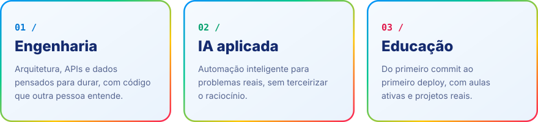
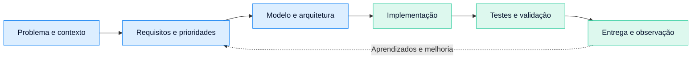
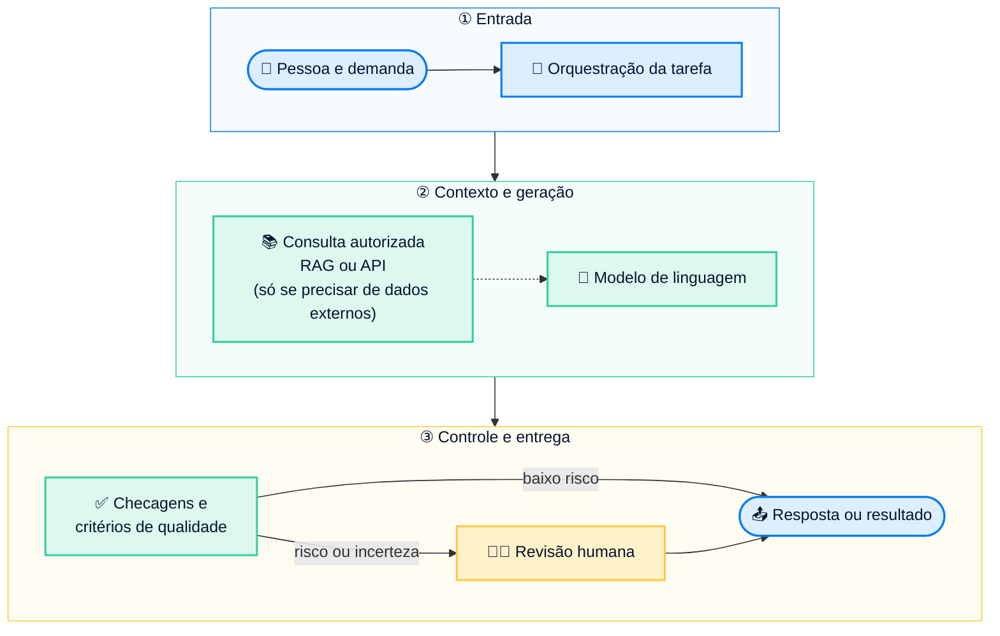
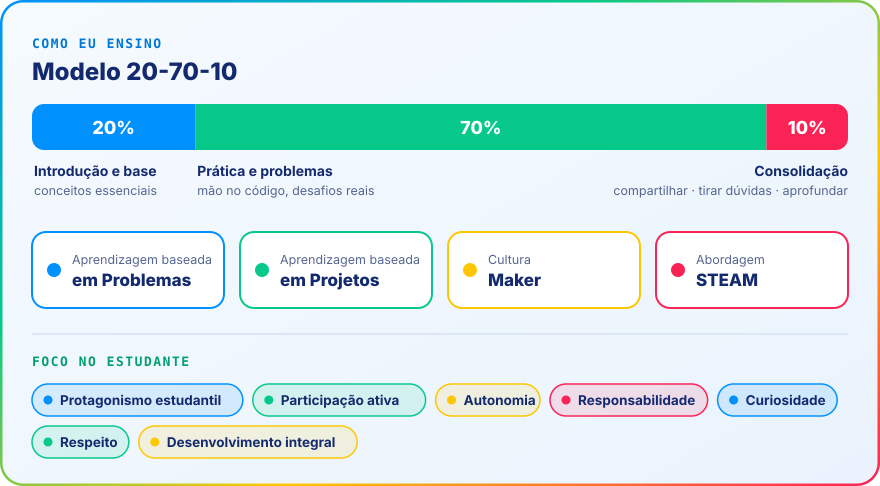

  
  
    
  

## helloWorld_

Oi, eu sou o Sandro! sou engenheiro de software, desenvolvedor full stack e professor de tecnologia. Há mais de 20 anos trabalho em diferentes contextos de desenvolvimento e formação profissional, aproximando **engenharia, educação e problemas que existem fora das apresentações**.

Uma parte importante da minha trajetória foi construída no desenvolvimento de aplicações web, integrações, APIs e soluções para organizações. A outra acontece em salas de aula, laboratórios e projetos integradores, ajudando estudantes a transformar conhecimento em repertório técnico, autonomia e capacidade de tomar decisões. Essas frentes não competem entre si: uma melhora a outra.

Minha atuação docente inclui experiências em **FIAP, Senac RS e Fundatec**. Além da formação profissional, já participei de iniciativas que aproximam tecnologia e responsabilidade social, como ações de recuperação de equipamentos com participação de estudantes durante as enchentes no Rio Grande do Sul. São situações em que conhecimento técnico precisa se converter em ação responsável e útil.

**Este GitHub é o lugar onde organizo o lado demonstrável desse trabalho.** Aqui você encontra projetos, experimentos, materiais de ensino, ferramentas e decisões de arquitetura que podem ser estudados, executados, adaptados ou discutidos conforme a finalidade de cada repositório.

  
  <blockquote style="font-size:18px; padding:10px; margin:30px 0;">Tecnologia não se torna valiosa por ser complexa. Ela ganha valor quando resolve um problema, pode ser compreendida e permanece útil depois da primeira entrega.</blockquote>
  

**Por onde começar:** [projetos](#projetos-que-valem-a-visita) · [engenharia](#como-penso-e-construo) · [educação](#como-ensino) · [tecnologias](#stack-e-ferramentas) · [comunidade](#conteudo-comunidade-e-contato)

 

## 👨‍💻 Projetos que valem a visita

Prefiro apresentar projetos com uma finalidade clara a usar uma parede de logos como argumento de competência. Os exemplos a seguir mostram diferentes partes do meu trabalho, de automação e interfaces a atividades didáticas e soluções voltadas à educação.

| Projeto | Por que vale conhecer |
|---|---|
| **[SummumOpus](https://github.com/eisandromc/SummumOpus)** · PowerShell | Explora auditoria, configuração, otimização e observabilidade do Windows. Um ponto de partida para discutir automação, critérios operacionais e responsabilidade ao intervir em sistemas. |
| **[Oficina E-commerce](https://github.com/eisandromc/oficina-ecommerce)** · JavaScript | Exercício de carrinho de compras para estudar manipulação do DOM, estado da interface e estruturas de dados em um problema familiar. |
| **[CSS Moderno](https://github.com/eisandromc/css-moderno-container-queries-has-subgrid)** · HTML/CSS | Demonstra Container Queries, `:has()` e Subgrid. O objetivo é compreender quando os recursos melhoram a organização e a adaptação das interfaces. |
| **[Modularização, Componentes e Microsserviços](https://github.com/eisandromc/modularizacao-componentes-microsservios)** · JavaScript | Material para discutir separação de responsabilidades, composição e limites arquiteturais com exemplos navegáveis. |
| **[Cards de Produtos](https://github.com/eisandromc/fiap_front-end-design_cards-produtos)** · Front-end | Atividade de interface para observar hierarquia, espaçamento, contraste e componentes reutilizáveis em um cenário de catálogo. |
| **[Sistema de Banca Avaliativa](https://github.com/eisandromc/sistema-banca-avaliativa)** · Educação e produto | Projeto relacionado à organização do processo de apresentação e avaliação de trabalhos acadêmicos. Consulte o repositório para verificar seu estágio e escopo. |

A organização do conteúdo, a documentação e as licenças variam conforme a finalidade e a maturidade de cada projeto. Nem todo repositório é um produto pronto para produção; alguns foram concebidos para experimentar, ensinar ou documentar uma abordagem.

**[Explorar todos os repositórios](https://github.com/eisandromc?tab=repositories)**

 

## 🧠 Como penso e construo

Minha referência inicial não é uma linguagem, um framework ou a ferramenta mais recente. É **o problema a resolver, quem será afetado pela solução e quais restrições precisam ser respeitadas**. A arquitetura deve surgir dessas decisões, com complexidade proporcional ao contexto.

Costumo organizar a análise técnica em cinco perguntas: qual resultado é esperado; quais dados e integrações são necessários; o que precisa ser confiável e seguro; como o trabalho será validado; e como alguém conseguirá manter a solução depois. A documentação é parte dessa conversa, não um artefato preparado apenas no encerramento.

### Engenharia com IA, sem promessas impossíveis

Em soluções que usam modelos de linguagem, procuro separar **instruções, conhecimento recuperado, ferramentas externas, validação e decisão humana**. Um modelo pode ajudar a interpretar ou produzir informações, mas isso não substitui controle de acesso, testes, rastreabilidade ou revisão quando o risco exige.

RAG e integrações por ferramentas podem ser úteis, mas não são requisitos de toda aplicação. O desenho abaixo representa **uma arquitetura possível**, não uma garantia de precisão ou uma configuração implantada em todos os projetos.

Um princípio orienta essas decisões: **menos improvisação naquilo que importa; mais espaço para experimentar onde o erro é controlável**. Quem mantém um sistema precisa entender suas escolhas, não apenas admirar o resultado na demonstração.

 
 
## 🎓 Como ensino

A experiência como professor molda minha forma de desenvolver e comunicar tecnologia. Tenho atuado na formação técnica e no ensino superior, aproximando programação, projetos integradores, arquitetura e empregabilidade. O ponto de partida é sempre tornar o aprendizado **compreensível, praticável e transferível para novos desafios**.

  

O **20-70-10 é uma referência de planejamento que utilizo**, não uma proporção universal ou rígida: uma parte do encontro organiza o conhecimento, a maior parte privilegia investigação e prática e outra parte consolida decisões, dúvidas e aprendizados. A distribuição precisa mudar de acordo com os objetivos, o tempo disponível, o repertório da turma e as necessidades de acessibilidade.

O estudante aprende melhor quando consegue explicar **o que construiu, por que decidiu daquele modo, como verificou o resultado e o que faria diferente**. Por isso, valorizo exercícios reproduzíveis, atividades de projeto, colaboração, documentação, pensamento crítico e espaço real para revisão e erro.

Não se trata de substituir teoria por atividade incessante. Trata-se de dar à teoria o lugar que ela merece: **fundamentar escolhas práticas**. E lembrar que copiar código sem compreender a decisão não é exatamente a habilidade mais disputada do mercado.

 

## 🛠️ Stack e ferramentas

Minha base de atuação reúne tecnologias web, integração de sistemas, dados e ferramentas de desenvolvimento. Nesta vitrine, priorizo o conjunto mais relacionado aos projetos e aos conteúdos apresentados, em vez de tratar toda ferramenta explorada como especialidade consolidada.

| Grupo | Tecnologias |
|---|---|
| **Linguagens** |  |
| **Front-end** |  |
| **Mobile** |  |
| **Back-end** |  |
| **Banco de dados** |  |
| **Mensageria** |  |
| **IA e dados** |           |
| **DevOps e infra** |  |
| **Ferramentas e design** |  |

Quando uma tecnologia aparece em uma demonstração, procuro deixar clara sua finalidade: o problema que ela resolve, as limitações relevantes e as alternativas possíveis. Uma lista de ferramentas pode ser extensa; capacidade de decisão é o que faz diferença.

 

## 🌐 Conteúdo, comunidade e contato

Compartilho experiências e materiais sobre programação, engenharia de software, arquitetura, educação tecnológica, IA aplicada e desenvolvimento profissional. O conteúdo pode assumir a forma de demonstração, atividade de aula, estudo de caso, experimento ou reflexão técnica. A proposta é a mesma: sair da abstração e gerar algo que outra pessoa consiga aproveitar

Para estudantes, valorizo caminhos que desenvolvem autonomia e repertório. Para profissionais, discussões sobre decisões, manutenção, ferramentas e evolução de carreira. Para instituições e equipes, projetos, oficinas e experiências de aprendizagem conectadas a situações reais.

<!-- Para adicionar um membership: copie uma linha da tabela abaixo e troque o nome, o badge e o link.
Badge sem ícone: https://img.shields.io/badge/NOME-COR?style=for-the-badge
Badge com ícone: acrescente &logo=NOME-DO-ICONE&logoColor=white (nomes em https://simpleicons.org) -->

| Community | Perfil |
|---|---|
|  | [dev.to/eisandromc](https://dev.to/eisandromc) |
|  | [tabnews.com.br/eisandromc](https://www.tabnews.com.br/eisandromc) |
|  | [medium.com/@eisandromc](https://medium.com/@eisandromc) |
|  | [g.dev/eisandromc](https://g.dev/eisandromc) |
|  | [developer.nvidia.com](https://developer.nvidia.com/) |
|  | [stackoverflow.com/users/26036021/eisandromc](https://stackoverflow.com/users/26036021/eisandromc) |
|  | [reddit.com/user/eisandromc](https://www.reddit.com/user/eisandromc/) |

 

## 🤝 Vamos conversar?

Se você quer desenvolver um projeto, discutir uma decisão de arquitetura, planejar uma formação técnica ou compartilhar uma experiência de aprendizagem, podemos conversar. Gosto especialmente de iniciativas que reúnam **problemas reais, boa engenharia e pessoas dispostas a aprender juntas**.

 <blockquote style="font-size:18px; padding:10px; margin:30px 0;"Aprender, construir e compartilhar. Com critério, curiosidade e propósito.

📬 Fale comigo pelo [LinkedIn](https://www.linkedin.com/in/eisandromc) ou pelo [site](https://www.sandromartins.com.br). Se algum repositório te ajudou, deixe uma ⭐
</blockquote>
